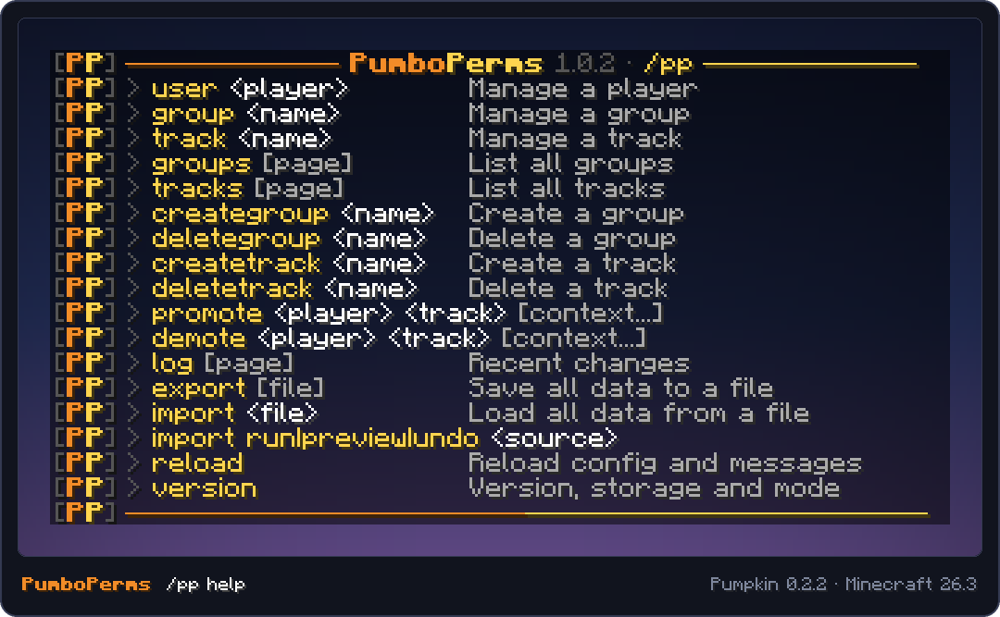
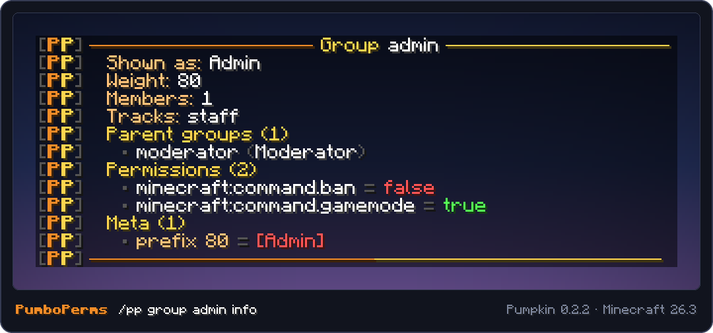
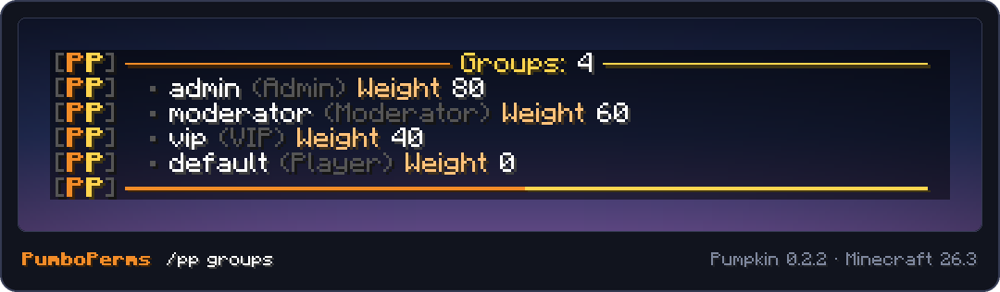
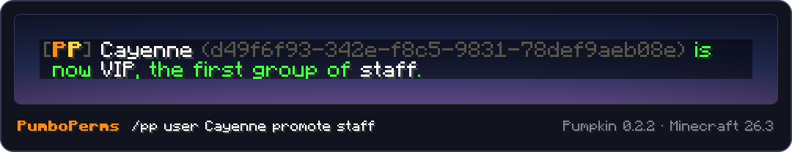
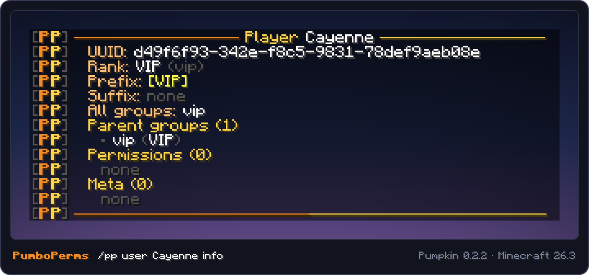
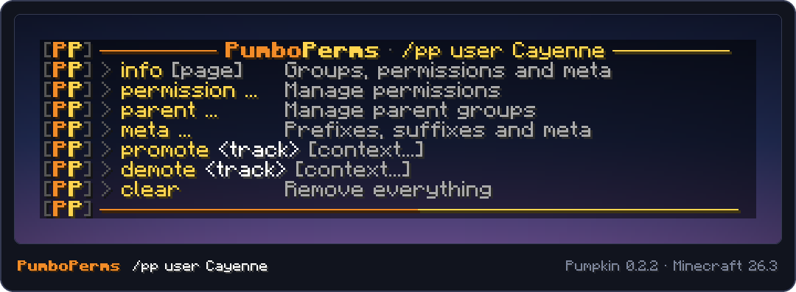

# Screenshots

PumboPerms at work. Every picture is drawn from what the plugin sent to a Minecraft 26.3 client on a Pumpkin 0.2.2 server.

## /pp help

  

## /pp group admin info

  

## /pp groups

  

## /pp user Cayenne promote staff

  

## /pp user Cayenne info

  

## /pp user Cayenne

  

