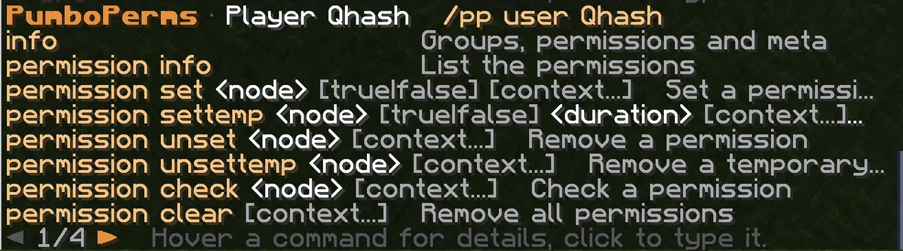
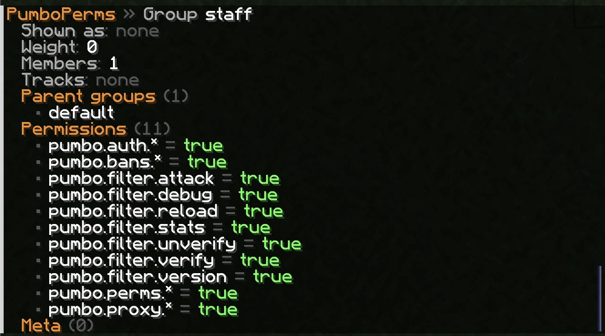

# PumboPerms

Ranks and permissions for Pumpkin servers. Put players into groups, give the groups permissions and prefixes, and move players up and down rank ladders. On the first start PumboPerms takes over the permissions your server already has.

## Features

- **Groups with inheritance and weights.** A group gets the permissions of its parents. When two groups disagree, the heavier one wins.
- **Wildcards.** `minecraft:command.*` or `*`. The most specific node decides, and PumboPerms gives Pumpkin a list it reads the same way for every permission that Pumpkin, the Pumbo plugins or your groups and players name.
- **Temporary ranks.** Permissions, groups and prefixes for `1h30m` or `7d`. They end on their own.
- **Contexts.** `world=world_nether` limits a permission, a group or a prefix to one world.
- **Prefixes and suffixes** with priorities, plus your own meta values.
- **Rank ladders** with `/pp promote` and `/pp demote`.
- **Change log, JSON export and import**, with undo.
- **Tab completion** for subcommands, players, groups, tracks and permission nodes, with the name of the next argument above the chat box.
- **Placeholders for other plugins** (from 0.1.2-beta): `%pumboperms_prefix%`, `%pumboperms_rank%` and more for chat, tab and scoreboard plugins. How to use them: [INTEGRATION.md](https://github.com/PumboMC/PumboPerms/blob/main/INTEGRATION.md).
- **Closes a Pumpkin 0.2.0 hole.** There `/tp`, `/xp`, `/banip` and `/pardonip` skip the permission check. PumboPerms blocks them for players without the permission.

## Quick start

```
/pp creategroup vip
/pp group vip parent add default
/pp group vip setweight 10
/pp group vip permission set minecraft:command.gamemode
/pp group vip meta setprefix 10 "&6[VIP] "
/pp user Steve parent add vip
```

## Commands

| Command | What it does |
| --- | --- |
| `/pp user <player> info` | Groups, permissions and meta of a player |
| `/pp user <player> permission set\|settemp\|unset\|unsettemp\|check\|clear` | Give, take or check permissions |
| `/pp user <player> parent add\|addtemp\|remove\|removetemp\|set <group>` | Change a player's groups |
| `/pp user <player> meta set\|unset\|setprefix\|addprefix\|addtempprefix\|removeprefix\|removetempprefix ...` | Meta, prefixes and suffixes (`...suffix` the same way) |
| `/pp user <player> promote\|demote <track>` / `clear` | Move a player on a track, remove everything |
| `/pp group <name> ...` | The same for groups, plus `rename`, `setweight`, `setdisplayname`, `listmembers` |
| `/pp creategroup` / `deletegroup` / `groups` | Create, delete or list groups |
| `/pp createtrack` / `deletetrack` / `tracks` | Create, delete or list tracks |
| `/pp track <name> info\|append\|insert\|remove\|clear` | Build a rank ladder |
| `/pp promote <player> <track>` / `demote` | Move a player one step |
| `/pp log` / `export` / `import` | Change log, backup, restore |
| `/pp reload` / `version` | Reload the config, show the version |

`/pp help` shows every command you may use. `/pp` is short for `/pumboperms` (change or remove it with `commands.aliases` in the config), and `u`, `g`, `t` work for `user`, `group`, `track`. Permissions are named `pumboperms:<name>` and default to operators of level 3.

## Screenshots





## Installation

Drop the file into `plugins/` and start the server. The config is created in `plugins/data/pumboperms/`.

Works with Pumpkin 0.2.0+26.3-26.51 (Minecraft 26.3) and Pumpkin 0.1.0-dev+26.2-26.45 (Minecraft 26.2), both with the plugin API `pumpkin:plugin@0.1.0`. A file only loads on the Pumpkin version it was built for. This market carries the file for Pumpkin 0.2.0; the files for 0.1.0-dev and PumboProx are in the [GitHub releases](https://github.com/PumboMC/PumboPerms/releases/latest). Keep the file in `plugins/` under one name, so an update replaces it: `PumboPerms-26.3.wasm` for Pumpkin 0.2.0, `PumboPerms-26.2.wasm` for Pumpkin 0.1.0-dev, `pumbo-perms.wasm` for PumboProx. The files in the GitHub releases have the version in their names; rename them to these.

Updating from 0.1.2-beta: run `/pp export` before you replace the file. The new version moves its import records into the database on the first start, and 0.1.2-beta cannot open that database afterwards.

## Running a network?

PumboPerms also runs on [PumboProx](https://github.com/PumboMC/PumboProx): one set of ranks for every server, with differences per server where you need them.

---

PumboPerms is in beta. Try it on a test server before you put players on it.
Source, documentation and issues: https://github.com/PumboMC/PumboPerms (GPL-3.0)

[](https://github.com/PumboMC/PumboProx)
