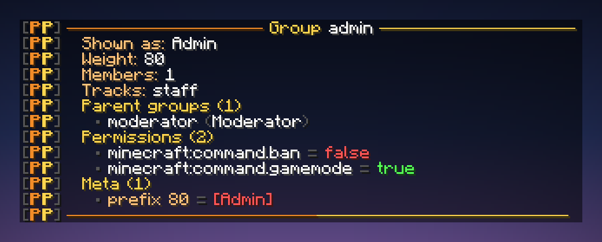
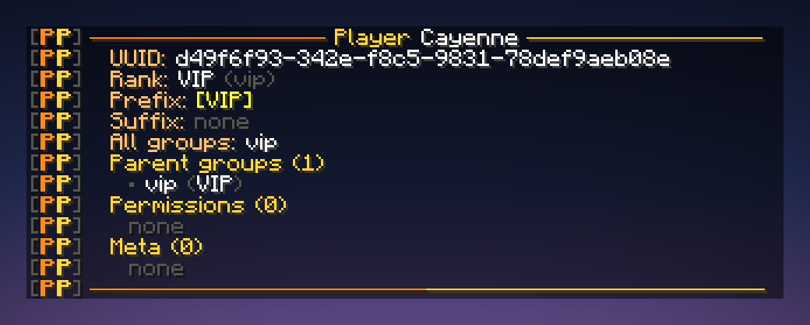
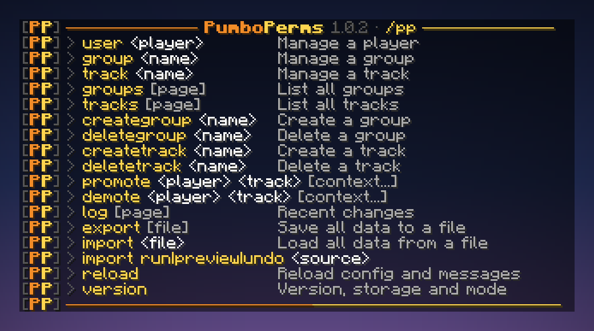

The project is 100% open source under GPL-3.0: [PumboPerms on GitHub](https://github.com/PumboMC/PumboPerms).

No code or parts was copied from [LuckPerms](https://github.com/LuckPerms/LuckPerms), but is strongly modeled on, that why we still want to thank [@lucko](https://github.com/lucko) for the solutions and standards it gave us.

## No restart or reload needed

Permissions and groups apply at once, without a restart or reload.

## How it looks

### A group

`/pp group admin info` shows the weight, the members, the tracks, the parent groups, the permissions and the meta of a group.

### A player

`/pp user Cayenne info` shows the rank, the prefix and the groups of a player, with the permissions and the meta set on the player alone.

### Tracks

`/pp user Cayenne promote staff` moves the player one group up the track.

## Commands

`/pp help` lists the commands you may use; click one to type it. `/pp` is short for `/pumboperms`. The [command list](https://github.com/PumboMC/PumboPerms/blob/main/docs/commands.md) has every argument and permission.

## Pumpkin versions

Each Pumpkin release loads only its own file:

- Pumpkin 0.2.1+26.3-26.51 and 0.2.2+26.3-26.60: the file here, or `PumboPerms-v<version>-for-Pumpkin-0.2.1-and-0.2.2.wasm` from GitHub
- Pumpkin 0.2.0+26.3-26.51: `PumboPerms-v<version>-for-Pumpkin-0.2.0.wasm` from GitHub
- Pumpkin 0.1.0-dev+26.2-26.45: `PumboPerms-v<version>-for-Pumpkin-0.1.0-dev.wasm` from GitHub

The GitHub files are in the [latest release](https://github.com/PumboMC/PumboPerms/releases/latest).

On Pumpkin 0.2.2 `/pp` has no Tab completion of player and group names: Pumpkin 0.2.2 crashes when a player asks a plugin for completions. It comes back with a PumboPerms update once Pumpkin ships [a fix](https://github.com/Pumpkin-MC/Pumpkin/pull/4149).

## Running a network?

PumboPerms also runs on [PumboProx](https://github.com/PumboMC/PumboProx): ranks live in one place for the whole network and can differ from server to server.

## Project Pages

- [Roadmap](https://github.com/PumboMC/PumboPerms/blob/main/docs/roadmap.md)
- [Features](https://github.com/PumboMC/PumboPerms/blob/main/docs/features.md)
- [Installation](https://github.com/PumboMC/PumboPerms/blob/main/docs/installation.md)
- [Commands](https://github.com/PumboMC/PumboPerms/blob/main/docs/commands.md)
- [Performance](https://github.com/PumboMC/PumboPerms/blob/main/docs/how-it-works.md#limits)
- [Changelog](https://github.com/PumboMC/PumboPerms/blob/main/CHANGELOG.md)
- [Bug reports](https://github.com/PumboMC/PumboPerms/issues)

## License

PumboPerms is licensed under the GNU General Public License v3.0. It is not affiliated with Mojang, Microsoft or the Pumpkin project.

